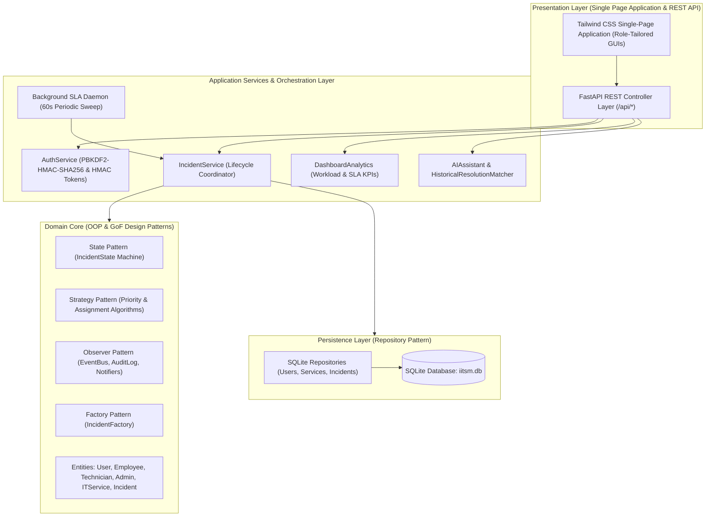
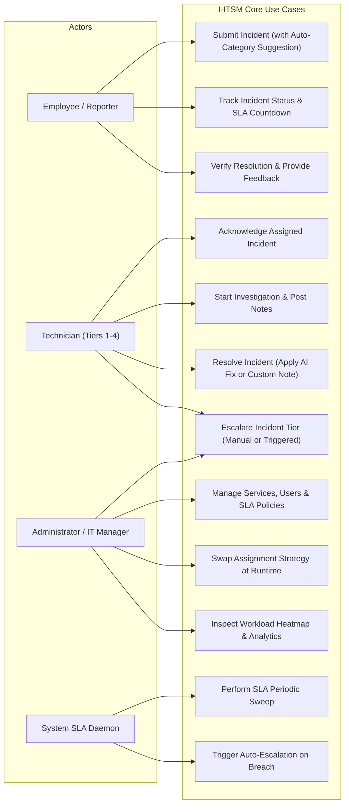
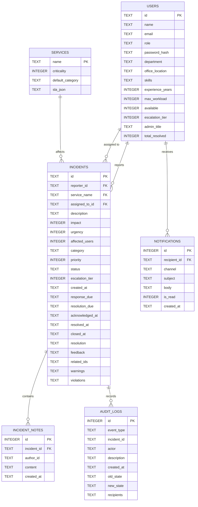

# Intelligent IT Service Management & Incident Resolution System (I-ITSM)
## Academic Project Report & Technical Specification
**Course**: CS F213 / MAC F212 Object Oriented Programming (Semester-I, 2026-2027)  
**Institution**: Birla Institute of Technology and Science, Pilani (BITS Pilani), Hyderabad Campus  
**Deadline**: November 22, 2026 | **Maximum Marks**: 120  

---

## Team Contributions & Project Responsibilities

| Student Name | ID Number | Course / Campus | Core Module Responsibilities |
|:---|:---|:---|:---|
| **Kuna Ruthwik** | 2025A7PS0004H | BITS Pilani, Hyderabad Campus | Architecture, FastAPI REST API Controller, Security & Authentication (PBKDF2/HMAC), SQLite Persistence & 8-Criteria Repository |
| **Balla Sadhana** | 2025A7PS0001H | BITS Pilani, Hyderabad Campus | Domain Modeling, State Machine Lifecycle, Incident Factory, Exception Handling, Web UI |
| **Arcot Meheq Sulthana** | 2025A7PS0002H | BITS Pilani, Hyderabad Campus | Strategy Pattern (Dynamic Weighted Priority Engine & Runtime Swappable Assignment Strategies), Duplicate Detection, NLP Classifier |
| **Thotapalli Rahul Apurup** | 2025A7PS0083H | BITS Pilani, Hyderabad Campus | Observer Pattern (EventBus, Audit Logging, Notifiers), SLA Daemon & 4-Tier Automated Escalation, AI Diagnostics Copilot, 51-Test Automated Suite |

---

## 1. Problem Analysis & Operational Context

In modern enterprise IT operations, uninterrupted digital service availability is critical to core business processes, customer trust, and financial settlements. Traditional service desks often rely on disjointed spreadsheets or legacy ticketing software characterized by several fundamental operational deficiencies:

### 1.1 Existing Challenges in Legacy ITSM
- **Manual, Subjective Prioritization**: Incidents are prioritized based on user complaints rather than quantitative calculations incorporating business service criticality, impact breadth, and user volume.
- **Static, Inefficient Technician Allocation**: Workload imbalances frequently occur because systems lack skill-aware matching and real-time technician capacity limits.
- **Unenforced Incident Lifecycles**: Tickets frequently jump illegally across states (such as jumping directly from creation to closed), resulting in unverified fixes, missing investigation notes, and lack of accountability.
- **Reactive, Untracked SLA Management**: Service Level Agreements are calculated retrospectively rather than monitored proactively, allowing deadlines to elapse without warning.
- **Fragmented, Modifiable Audit Logs**: Lack of immutable event capture makes compliance auditing and post-mortem root-cause analysis unreliable.

### 1.2 Key Stakeholders
- **Employees / Customers**: Non-technical corporate staff who report service disruptions, monitor turnaround times, and verify resolution quality.
- **Support Technicians (Tiers 1-4)**: Support engineers, senior specialists, systems architects, and IT operations managers who investigate root causes, post notes, execute resolutions, and manage escalations.
- **IT Administrators & Managers**: Leadership overseeing SLA policies, service catalogs, assignment strategy selection, and enterprise-wide workload heatmaps.

### 1.3 Key Assumptions
- The system operates within an enterprise intranet communicating over HTTP/JSON REST APIs with role-based bearer token authorization.
- Technicians declare category competencies upon registration, and their maximum active workload threshold is strictly enforced.
- Incident SLA timers progress continuously based on wall-clock time with an automated 60-second background evaluation daemon.

---

## 2. Requirements Specification & Business Rules

### 2.1 Functional Requirements (FR)
- **FR-1 (Authentication & Authorization)**: The system must authenticate users using salted PBKDF2-HMAC-SHA256 password hashing and issue stateless HMAC-SHA256 signed bearer tokens. Strict Role-Based Access Control (RBAC) must restrict operations by role.
- **FR-2 (Incident Creation & Auto-Categorization)**: Employees must be able to file incidents specifying service, impact, urgency, and affected users. A rule-based NLP classifier must automatically suggest matching categories in real-time.
- **FR-3 (Automated Priority Calculation)**: Priority (P1 Critical through P4 Low) must be computed dynamically using the formula:
  $$\text{Score} = \text{Impact} \times \text{Urgency} \times \text{Business Criticality} \times \text{Crowd Multiplier}$$
- **FR-4 (Swappable Technician Assignment)**: The system must provide at least two assignment strategies (Skill-Based, Load-Based, and Round-Robin) that administrators can switch at runtime without altering core logic.
- **FR-5 (Investigation & AI-Assisted Resolution)**: Technicians must be able to acknowledge tickets, post investigation notes, and access an AI diagnostic engine that matches past similar resolutions and synthesizes diagnostic checklists.
- **FR-6 (Verification & Closure)**: Resolved incidents must be verified by the original reporting employee with qualitative feedback before final administrative closure.
- **FR-7 (SLA Monitoring & Auto-Escalation)**: The system must enforce response and resolution targets per priority tier, trigger warnings when 80% of allowed duration has elapsed, and automatically escalate breached tickets across a 4-tier technician hierarchy.
- **FR-8 (Multi-Criteria Search & Auditing)**: The platform must support searching across eight distinct criteria and capture an immutable append-only audit trail for every state transition.

### 2.2 Non-Functional Requirements (NFR)
- **NFR-1 (Performance)**: All REST API queries and searches must complete with sub-second latency under normal enterprise load.
- **NFR-2 (Security & Isolation)**: Passwords must be securely hashed with 100,000 iterations. Employees must be strictly restricted to viewing only their own reported incidents.
- **NFR-3 (Extensibility & Modularity)**: Domain models must remain decoupled from database persistence via the Repository Pattern, and event delivery must be decoupled via the Observer Pattern.
- **NFR-4 (Reliability & Robustness)**: All database transactions must adhere to ACID guarantees using SQLite, and invalid state transitions or unauthorized actions must raise domain-specific custom exceptions.

### 2.3 Business Rules (BR)
- **BR-1 (State Transition Enforceability)**: Transitions must follow the sequential order: `NEW` $\rightarrow$ `CLASSIFIED` $\rightarrow$ `ASSIGNED` $\rightarrow$ `ACKNOWLEDGED` $\rightarrow$ `IN_PROGRESS` $\rightarrow$ `RESOLVED` $\rightarrow$ `VERIFIED` $\rightarrow$ `CLOSED`. Any invalid jump raises `InvalidStateTransition`.
- **BR-2 (Reporter Data Scoping)**: Employees can only view, track, and verify incidents where `reporter_id` matches their authenticated user ID.
- **BR-3 (Capacity Ceiling)**: A technician cannot be assigned new tickets if active assigned incidents equal their declared `max_workload`.
- **BR-4 (Automated Breach Escalation)**: Any ticket exceeding its resolution SLA target is automatically escalated to a higher-tier engineer (`Tier 1 Support Tech` $\rightarrow$ `Tier 2 Team Lead` $\rightarrow$ `Tier 3 SysAdmin` $\rightarrow$ `Tier 4 IT Manager`).

---

## 2. System Architecture & Component Design

The platform adopts a clean, layered architectural pattern consisting of Presentation, Application Service, Domain Core, and Persistence layers.

---

## 3. UML Use Case Diagram

---

## 4. UML Class Diagram

The UML Class Diagram illustrates class structures, member visibility, inheritance hierarchies, interfaces, and design patterns.

```mermaid
classDiagram
    %% Users Hierarchy
    class User {
        <<abstract>>
        -str id
        -str name
        -str email
        +str password_hash
        +Role role*
        +can(action: str)* bool
    }

    class Employee {
        +str department
        +str office_location
        +can(action: str) bool
    }

    class Technician {
        -frozenset skills
        +int experience_years
        +int max_workload
        +bool available
        +EscalationTier escalation_tier
        +int total_resolved
        -set active_incidents
        +workload() int
        +has_capacity() bool
        +take(incident_id: str)
        +release(incident_id: str)
        +record_resolution(incident_id: str)
        +can(action: str) bool
    }

    class Administrator {
        +str admin_title
        +can(action: str) bool
    }

    User <|-- Employee
    User <|-- Technician
    User <|-- Administrator

    %% Domain Entities
    class ITService {
        +str name
        +int criticality
        +str default_category
        +SLAPolicy sla_policy
    }

    class SLAPolicy {
        -dict targets
        +targets_for(priority: Priority) tuple
    }

    class Incident {
        +str id
        +User reporter
        +str description
        +ITService service
        +int impact
        +int urgency
        +int affected_users
        +str category
        +Priority priority
        +Technician assigned_to
        +EscalationTier escalation_tier
        +datetime created_at
        +datetime response_due
        +datetime resolution_due
        +datetime acknowledged_at
        +datetime resolved_at
        +datetime closed_at
        +str resolution
        +str feedback
        +list related
        +set warnings
        +set violations
        -IncidentState state
        +status() Status
        +move_to(target: Status) tuple
    }

    ITService "1" *-- "1" SLAPolicy
    Incident "1" o-- "1" ITService
    Incident "1" o-- "1" User : reporter
    Incident "1" o-- "0..1" Technician : assigned_to

    %% State Pattern
    class IncidentState {
        <<abstract>>
        +Status status*
        +next(target: Status)* IncidentState
    }

    class NewState
    class ClassifiedState
    class AssignedState
    class AcknowledgedState
    class InProgressState
    class ResolvedState
    class VerifiedState
    class ClosedState

    IncidentState <|-- NewState
    IncidentState <|-- ClassifiedState
    IncidentState <|-- AssignedState
    IncidentState <|-- AcknowledgedState
    IncidentState <|-- InProgressState
    IncidentState <|-- ResolvedState
    IncidentState <|-- VerifiedState
    IncidentState <|-- ClosedState
    Incident "1" *-- "1" IncidentState

    %% Strategy Pattern
    class AssignmentStrategy {
        <<interface>>
        +select(incident: Incident, technicians: list)* Technician
    }

    class SkillBasedAssignment {
        +select(incident: Incident, technicians: list) Technician
    }

    class LoadBasedAssignment {
        +select(incident: Incident, technicians: list) Technician
    }

    class RoundRobinAssignment {
        -int cursor
        +select(incident: Incident, technicians: list) Technician
    }

    AssignmentStrategy <|.. SkillBasedAssignment
    AssignmentStrategy <|.. LoadBasedAssignment
    AssignmentStrategy <|.. RoundRobinAssignment

    class PriorityStrategy {
        <<interface>>
        +calculate(incident: Incident)* Priority
    }

    class WeightedScorePriority {
        +calculate(incident: Incident) Priority
    }

    PriorityStrategy <|.. WeightedScorePriority

    %% Observer Pattern
    class Observer {
        <<interface>>
        +update(event: Event)*
    }

    class EventBus {
        -list observers
        +subscribe(observer: Observer)
        +publish(event: Event)
    }

    class SQLiteAuditLog {
        +update(event: Event)
        +history(incident_id: str) list
    }

    class NotificationObserver {
        +update(event: Event)
    }

    Observer <|.. SQLiteAuditLog
    Observer <|.. NotificationObserver
    EventBus o-- Observer

    %% Service & Repositories
    class IncidentService {
        -Repository incidents
        -Repository users
        -Repository services
        -EventBus bus
        -PriorityStrategy priority
        -AssignmentStrategy assignment
        -CategoryCatalog catalog
        -DuplicateDetector duplicates
        -SLAMonitor sla
        +report(...) Incident
        +assign(incident_id: str) Incident
        +acknowledge(tech_id: str, inc_id: str) Incident
        +start_investigation(tech_id: str, inc_id: str) Incident
        +add_note(tech_id: str, inc_id: str, note: str) Incident
        +resolve(tech_id: str, inc_id: str, resolution: str) Incident
        +verify(user_id: str, inc_id: str, feedback: str) Incident
        +close(user_id: str, inc_id: str) Incident
        +escalate(incident_id: str, reason: str) Incident
        +recommend_technicians(incident_id: str) list
    }

    IncidentService o-- AssignmentStrategy
    IncidentService o-- PriorityStrategy
    IncidentService o-- EventBus
```

---

## 5. Database ER Diagram & Relational Schema

Persistent data is managed inside SQLite (`iitsm.db`) via the Repository Pattern.

### 5.1 Sample Relational Database Records

#### Table: USERS (Sample Records)
| id | name | email | role | department | skills | max_workload | escalation_tier |
|:---|:---|:---|:---|:---|:---|:---|:---|
| `emp1` | Priya Sharma | priya.sharma@corp.internal | `EMPLOYEE` | Finance | *NULL* | 5 | 1 |
| `emp2` | James Wilson | james.wilson@corp.internal | `EMPLOYEE` | Engineering | *NULL* | 5 | 1 |
| `tech_t1_1`| Alex Rivera | alex.t1@iitsm.internal | `TECHNICIAN` | *NULL* | `NETWORK,HARDWARE` | 5 | 1 |
| `tech_t2_1`| David Kim | david.lead@iitsm.internal | `TECHNICIAN` | *NULL* | `NETWORK,CLOUD,SECURITY` | 6 | 2 |
| `admin1` | Chakradhar Reddy | chakri.admin@iitsm.internal | `ADMIN` | *NULL* | *NULL* | 5 | 1 |

#### Table: SERVICES (Sample Records)
| name | criticality | default_category | sla_json |
|:---|:---|:---|:---|
| `Payment Gateway` | 5 | APPLICATION | DEFAULT |
| `Corporate VPN` | 4 | NETWORK | DEFAULT |
| `Identity & SSO Service` | 5 | AUTHENTICATION | DEFAULT |

#### Table: INCIDENTS (Sample Records)
| id | reporter_id | service_name | impact | urgency | priority | status | assigned_to_id | category |
|:---|:---|:---|:---|:---|:---|:---|:---|:---|
| `INC1001` | `emp1` | Corporate VPN | 4 | 4 | 2 (P2) | `CLOSED` | `tech_t2_1` | NETWORK |
| `INC1002` | `emp2` | Payment Gateway | 5 | 5 | 1 (P1) | `IN_PROGRESS` | `tech_t1_2` | APPLICATION |

---

## 6. Technology Stack Selection Justification
*(Addressing the 9 specific required questions on page 12 of the Course Specification)*

### 1. Programming Language Choice: Python 3.12
Python was selected because it delivers clean, idiomatic object-oriented constructs (abstract base classes via `abc.ABC`, multiple inheritance, properties, dunder methods, type hinting) while avoiding the verbose boilerplate of enterprise Java. Python enables seamless prototyping of intelligent features (NLP tokenization, Jaccard set operations) and integrates directly with FastAPI and SQLite without requiring heavyweight build tools or container overhead.

### 2. GUI & Web Framework: FastAPI + Modern Tailwind CSS SPA
Instead of legacy desktop UI toolkits like Tkinter or Java Swing (which look dated, lack responsiveness, and are difficult to demo remotely), we implemented a modern Single-Page Application using Tailwind CSS, Lucide icons, and Vanilla JavaScript, served by an asynchronous FastAPI backend. This architecture provides distinct role-scoped views, real-time feedback, and accessible controls for live evaluation.

### 3. Database & Persistence Layer: SQLite + Repository Pattern
SQLite was chosen as the persistence engine because it provides a self-contained, zero-configuration, ACID-compliant relational database engine. By wrapping database operations inside the Repository Pattern (`SQLiteUserRepository`, `SQLiteServiceRepository`, `SQLiteIncidentRepository`), domain models remain decoupled from SQL syntax, ensuring that persistence mechanics can be swapped without touching core logic.

### 4. State Management: The State Pattern
The incident lifecycle is governed by the GoF State Pattern. Instead of scattered conditional checks (`if status == ...`), each status (`NEW`, `CLASSIFIED`, `ASSIGNED`, `ACKNOWLEDGED`, `IN_PROGRESS`, `RESOLVED`, `VERIFIED`, `CLOSED`) is an independent class inheriting from `IncidentState`. Any invalid transition (e.g., `NEW` to `CLOSED`) immediately raises a custom `InvalidStateTransition` exception.

### 5. Strategy Pattern: Priority & Technician Assignment
The Strategy Pattern is implemented for both priority calculation and technician assignment. Priority is calculated by `WeightedScorePriority` combining criticality, impact, urgency, and crowd scaling. Assignment strategies (`SkillBasedAssignment`, `LoadBasedAssignment`, `RoundRobinAssignment`) implement the `AssignmentStrategy` interface. An administrator can swap strategies at runtime via the API without restarting the application.

### 6. Observer Pattern: Decoupled Audit & Notifications
System notifications and audit logging are implemented using the Observer Pattern. An `EventBus` synchronously dispatches lifecycle events with observer fault isolation to decoupled listeners. When lifecycle events occur, the bus publishes an immutable `Event`. The `SQLiteAuditLog` writes the record to the database, while `NotificationObserver` dispatches notifications to `InAppNotifier` and `EmailNotifier`. Observers are isolated so that delivery failures never interrupt core workflows.

### 7. Factory Pattern: Incident Creation
The `IncidentFactory` encapsulates ticket validation, normalization, and sequence generation (`INC1001`, `INC1002`, ...). It enforces boundary conditions (such as non-empty descriptions, valid impact and urgency ratings between 1 and 5, and positive affected user counts) in a single centralized module.

### 8. Testing Strategy: pytest (with unittest-style test suites)
Run `python -m pytest -q` from the project root. The suite has 51 tests across three modules. The original 18 domain tests and 26 extended tests are joined by seven regression tests for the persistent application and its HTTP routes. These cover concurrent reporting, restart behavior, the report-to-close lifecycle, role-based access, SLA alert deduplication, custom targets, atomic rollback and administrator settings. Integration tests use temporary SQLite files.

### 9. Third-Party Libraries & Innovation Challenge
To fulfill the **Innovation Challenge (AI-assisted resolution recommendation)**, the system implements a hybrid AI engine:
1. `HistoricalResolutionMatcher`: Uses token overlap and category weighting across resolved and closed tickets to retrieve verified past fixes.
2. `AIAssistant`: Combines rule-based expert diagnostic templates with an optional Google Gemini LLM fallback (`gemini-1.5-flash`), returning root-cause hypotheses, step-by-step diagnostic checklists, and preventative advice.

### 10. Security Notes & Evaluation Limitations
- **Token Signing Secret**: The HMAC-SHA256 bearer token manager reads from the environment variable `IITSM_SECRET_KEY`, generating a random process-local key if the variable is unset. In production, this should be set to a cryptographically secure 256-bit secret.
- **Cross-Origin Resource Sharing (CORS)**: The REST API supports origin configuration via `IITSM_ALLOWED_ORIGINS`. The default permits the same-origin web client. Additional origins can be explicitly configured.
- **Demo Passwords**: All seeded users are initialized with the shared password `password123` (hashed via PBKDF2-HMAC-SHA256 with random 16-byte salt and 100,000 iterations). This is an intentional convenience for grading, whereas production deployment would mandate individual password generation and mandatory first-login resets.
- **Data Isolation & Scoping**: The incident search and listing endpoint strictly enforces employee isolation. Even if an employee passes a foreign `?reporter_id=emp1` query parameter, the backend overrides the filter to `user.id`.

---

## 7. Automated Test Suite (26 Test Cases)

| Test ID | Module | Scenario / Description | Input Conditions | Expected Output | Status |
|:---|:---|:---|:---|:---|:---|
| **TC-01** | `auth` | Password hashing & constant-time check | String password with special chars | PBKDF2 hash starting with prefix, validates true | **PASS** |
| **TC-02** | `auth` | Auth token generation & decoding | Valid user credentials | Valid HMAC-SHA256 bearer token returned | **PASS** |
| **TC-03** | `models` | Role-based permission checks | Employee, Technician, Admin actions | Employees cannot resolve; Techs cannot create | **PASS** |
| **TC-04** | `service` | Full 8-step lifecycle progression | Sequential valid transitions | Moves `NEW` through `CLOSED` with notes | **PASS** |
| **TC-05** | `states` | Invalid state jump rejection | Direct jump `NEW` to `CLOSED` | `InvalidStateTransition` raised | **PASS** |
| **TC-06** | `strategies` | Runtime assignment strategy swap | Skill-based then Load-based swap | Assigns by skill first, then by least load | **PASS** |
| **TC-07** | `strategies` | Dynamic priority calculation | Impact 5, Urgency 5, Criticality 5 | Computes score $\ge 60 \rightarrow$ Priority P1 | **PASS** |
| **TC-08** | `sla` | SLA deadline computation & 80% warning | P1 incident advanced to 85% of target | Flagged with `RESOLUTION` approaching warning | **PASS** |
| **TC-09** | `sla` | SLA breach detection & callback trigger | Clock advanced past resolution deadline | `RESOLUTION` violation added, callback fired | **PASS** |
| **TC-10** | `service` | 4-tier automated escalation hierarchy | 3 consecutive tier escalations | Escalates Tier 1 $\rightarrow$ Tier 2 $\rightarrow$ Tier 3 $\rightarrow$ Tier 4 | **PASS** |
| **TC-11** | `service` | Smart technician recommendations | Incident with category `NETWORK` | Top tech has skill match and score $>60\%$ | **PASS** |
| **TC-12** | `intelligence`| Duplicate incident detection | Same user submitting identical issue | `DuplicateIncident` exception raised | **PASS** |
| **TC-13** | `intelligence`| Rule-based category auto-suggestion | "PostgreSQL query failed with deadlock" | Returns category `DATABASE` | **PASS** |
| **TC-14** | `repository` | Multi-criteria incident search | Service filter `Payment Gateway` | Returns only matching payment incidents | **PASS** |
| **TC-15** | `ai` | Historical resolution matching | Similar symptom on resolved VPN ticket | Matches historical fix with confidence score | **PASS** |
| **TC-16** | `models` | Maximum technician workload limit | Assigning when active load equals max | `WorkloadExceeded` exception raised | **PASS** |
| **TC-17** | `models` | Unavailable technician protection | Assigning to offline technician | `TechnicianUnavailable` exception raised | **PASS** |
| **TC-18** | `service` | Unauthorized technician investigation | Tech B acknowledging Tech A's ticket | `UnauthorizedOperation` exception raised | **PASS** |
| **TC-19** | `service` | Unauthorized resolution verification | Non-reporter verifying employee ticket | `UnauthorizedOperation` exception raised | **PASS** |
| **TC-20** | `service` | Missing SLA policy exception | Service created without SLA targets | `MissingSLAConfiguration` exception raised | **PASS** |
| **TC-21** | `service` | Input boundary validation | Blank description, invalid impact range | `InvalidInput` exception raised | **PASS** |
| **TC-22** | `events` | Immutable audit trail logging | State transitions and note events | Audit log captures ordered events with states | **PASS** |
| **TC-23** | `events` | Dual-channel notification dispatch | Incident creation and assignment events | Dispatches to both In-App and Email inboxes | **PASS** |
| **TC-24** | `analytics` | Operational KPI metrics & MTTR | Overview analytics calculation | Returns total, open, SLA compliance %, MTTR | **PASS** |
| **TC-25** | `strategies` | Round-robin cyclic distribution | 4 tickets assigned to 3 technicians | Rotates cyclically (Tech A $\rightarrow$ B $\rightarrow$ C $\rightarrow$ A) | **PASS** |
| **TC-26** | `security` | Employee incident scoping & data isolation | Employee queries list with foreign reporter query | Returns strictly only own reported incidents | **PASS** |
